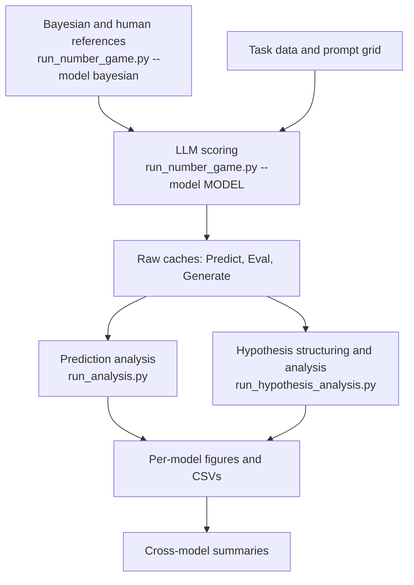

# Number Game: Generalization and Hypothesis Formation in LLMs

How do language models infer a rule from a few examples, and do the rules they report explain their predictions? This repository studies these questions with the **number game**, comparing LLM predictions and stated hypotheses with Bayesian models and human judgments.

[The experiment](#what-the-experiment-measures) · [Workflow](#workflow) · [Setup](#setup) · [Run an experiment](#run-an-experiment) · [Results](#configuration-and-outputs)

## What the experiment measures

Imagine an unknown program that accepts some numbers between 1 and 100. You learn that it accepts **16, 8, 2, and 64**. Would it also accept **32**? What about **18**?

Both “powers of two” and “even numbers” explain all four examples. They agree about 32 but disagree about 18. The experiment measures both how a model generalizes to new numbers and which explanations it considers plausible.

| Mode | Question asked of the LLM | Output |
| --- | --- | --- |
| **Predict** (`posterior`) | Would the program accept each number? | A membership probability for every target in the domain. |
| **Eval** (`hypothesis_eval`) | How probable is each rule in a supplied candidate list? | Probabilities assigned to candidate hypotheses. |
| **Generate** (`hypothesis_generation`) | What rules could explain these examples? | Free-text hypotheses with confidence values. |

In Predict mode, probabilities refer to separate membership judgments; they do not have to sum to one across numbers. For comparisons across modes, analysis converts interpretable hypotheses into the numbers they accept, then combines their predictions using the reported probabilities or confidences. Unresolved descriptions and unmatched mass are tracked explicitly.

Examples are revealed incrementally: `[16] → [16, 8] → [16, 8, 2] → [16, 8, 2, 64]`. This lets the analyses ask:

- **How does evidence change generalization?** Track prediction curves, uncertainty, and hypothesis narrowing as examples accumulate.
- **How does the model compare with humans and Bayesian inference?** Compare judgments and fit the relative influence of prior preferences and the size principle, which favors smaller hypotheses consistent with the evidence.
- **Do stated hypotheses agree with predictions?** Compare Predict, Eval, and Generate, and test their sensitivity to prompt framing and the number domain.

The default configuration includes two tasks:

| Task | Stimulus sets | Configured domains |
| --- | --- | --- |
| `Tenenbaum99` | 8 sets, including rule-evoking and tightly clustered examples. | `1..100`, `1..200` |
| `Bigelow16` | 255 sets from Bigelow & Piantadosi (2016). | `1..100` |

Human reference judgments are available in domain 100. The prompt grid varies whether candidate rules are described (`implicit` / `explicit`) and how examples are said to have been selected (`default`, `strong`, `weak`, and, for Tenenbaum99, `pedagogical` / `adversarial`). Eval always supplies candidates; Generate always leaves them open. See [tasks/README.md](tasks/README.md) for task sources, terminology, and precise evaluation semantics.

## Workflow



LLM scoring automatically launches prediction analysis, including per-condition plots, in a fresh process. Hypothesis analysis is a separate command: it turns precise generated descriptions into executable predicates before comparing the hypothesis modes. Cross-model summaries read the resulting analysis tables.

## Setup

Use Python 3.11+ and `uv`. Run commands from the repository root. Choose one Torch extra for your machine; CPU is sufficient for hosted-model requests and analysis:

```powershell
uv sync --extra cpu --group dev
# Or, for CUDA 12.8:
uv sync --extra cu128 --group dev
```

Other mutually exclusive extras are `mps`, `cu124`, `cu126`, and `cu130`. The commands below use `uv run`; an activated `.venv` can use `python` directly. Dependencies belong in [pyproject.toml](pyproject.toml); run `uv lock` after changing them.

The example model, `gpt54-mini`, uses the OpenAI backend and requires `OPENAI_API_KEY` in your environment. The Bayesian baseline needs no API credentials. Other hosted providers, local servers, and direct Hugging Face execution are described in [backends/README.md](backends/README.md).

## Run an experiment

Start with the shared baselines, then run the smaller Tenenbaum task in domain 100:

```powershell
# 1. Build shared Bayesian baselines and human reference analyses.
uv run run_number_game.py --model bayesian

# 2. Score all three modes for Tenenbaum99 using the mini prompt subset.
uv run run_number_game.py --model gpt54-mini --run-profile mini --task Tenenbaum99 --domain 100

# 3. Structure generated rules and analyze the hypothesis results.
uv run run_hypothesis_analysis.py --model gpt54-mini
```

Step 2 makes model requests and automatically runs prediction analysis. Step 3 also updates predicate libraries and hypothesis summaries; run structuring commands serially. The smaller run is a starting point, so some aggregate comparisons will require additional conditions.

To cover both tasks and all configured domains, remove the task/domain selectors. Choose `mini` for the prompt subset used by cross-model summaries, or `full` for the entire configured grid:

```powershell
uv run run_number_game.py --model gpt54-mini --run-profile mini
# Alternatively, run the full prompt grid:
uv run run_number_game.py --model gpt54-mini --run-profile full

uv run run_hypothesis_analysis.py --model gpt54-mini
uv run -m analysis.summary
```

`mini` reduces prompt conditions, not the stimulus sets or prefix lengths within each selected task. Both profiles share raw caches. The configured default is `full`; omitting `--model` uses the configured model. To compare models, repeat scoring and analysis with another alias from [configs/model_aliases.yml](configs/model_aliases.yml), then rebuild the summaries.

### Refresh analysis from existing results

```powershell
# Rebuild aggregate prediction metrics and figures.
uv run run_analysis.py --model gpt54-mini
# Also rebuild per-condition prediction figures and derived caches.
uv run run_analysis.py --model gpt54-mini --include-per-condition
# Refresh Bayesian and human reference analyses.
uv run run_analysis.py --model bayesian
# Rebuild cross-model prediction summaries from analysis CSVs.
uv run -m analysis.summary
```

Use `run_hypothesis_analysis.py` to refresh hypothesis results. Add `--thinking` to scoring and per-model analysis commands when working with thinking-mode results. See [analysis/README.md](analysis/README.md) for required inputs and figure meanings.

## Select conditions and reuse caches

Select a task, domain, prompt, or evaluation mode without editing the grid. For example, rate supplied hypotheses under a strong-sampling prompt for Bigelow16:

```powershell
uv run run_number_game.py --model gpt54-mini --task Bigelow16 --domain 100 --prompt explicit_strong --eval-mode hypothesis_eval
```

**Selectors schedule scoring; they are not inspection commands.** Missing raw files are computed. Existing files are reused only when their semantic identity, condition metadata, prefix set, and result shapes match; incompatible or incomplete files stop the run without being replaced. Files without `cache_identity` are incompatible.

To deliberately replace selected raw data, add `--refresh-raw-cache` to the same command. `OVERWRITE: true` is also an explicit overwrite policy. Profiles, selectors, concurrency, and retry settings do not change semantic cache identity.

LLM runs require existing compatible Bayesian caches and never rebuild them implicitly. Rebuild baselines after changing tasks, domains, or Bayesian settings. Aggregate analysis reads compatible caches across the configured grid, including conditions outside the latest scoring selection.

### Backends without logprobs

Predict mode can use Yes/No token probabilities (`logits`) or repeated full-domain binary judgments (`text_trials`). Backends without logprobs default to `text_trials`.

First run without `--allow-text-posterior` to inspect the pending-request and token estimate; when text-posterior scoring is needed, preflight stops before model requests. Repeat with `--allow-text-posterior` to proceed. Complete matching caches need no opt-in. `--posterior-method logits|text_trials` overrides the protocol; unsupported logits fail before scoring. Protocol and recovery details are in [backends/README.md](backends/README.md).

## Configuration and outputs

| File | Controls |
| --- | --- |
| [configs/number_game.yml](configs/number_game.yml) | Experiment grid, profiles, scoring, concurrency, and thinking budgets. |
| [configs/model_aliases.yml](configs/model_aliases.yml) | Model IDs, result names, default backends, and model-specific bindings. |
| [configs/backend_registry.py](configs/backend_registry.py) | Backend names, credentials, and shared provider policy. |
| [configs/generate.yml](configs/generate.yml) | Model-family sampling settings for hypothesis generation. |

Results live under `results/`, or `$DATA_DIR/number_game/results` when `DATA_DIR` is set:

```text
results/
  bayesian/{task}/d{domain}/               # shared baselines
  human/                                 # human reference analyses
  {model}/{task}/d{domain}/{prompt}/data/  # raw condition caches
  {model}/{task}/d{domain}/{prompt}/       # condition figures
  {model}/analysis/                       # analysis tables and caches
  {model}/                               # aggregate figures
  summary/                               # cross-model figures and tables
```

`{model}` is the configured result name, not necessarily the CLI alias: `gpt54-mini` writes to `GPT54_Mini/`, and its thinking run to `GPT54_Mini_thinking/`. `{prompt}` is `{h_space}_{sampling}`, such as `implicit_default`.

Domain 100 aggregate outputs use the model's root analysis/figure directories; other domains use `d{domain}/` underneath them. Cross-domain tables stay in the model's root `analysis/` directory.

For a first look, open `llm_panels.png` and `bayesian_panels.png` under a model's task/domain/prompt directory. They show model and Bayesian generalization curves, respectively, with human judgments where available. Then use the [figure guide](analysis/README.md#find-and-interpret-figures) to find evidence trajectories, hypothesis comparisons, and cross-model summaries. Outputs depend on which compatible caches are available.

## Code and documentation

| Area | Responsibility |
| --- | --- |
| [dataset/](dataset/README.txt) | Human judgments, descriptions, and source-data field definitions. |
| [tasks/](tasks/README.md) | Task data, prompts, and hypothesis spaces. |
| [backends/](backends/README.md) | Model execution, batching, thinking, and recovery. |
| `scoring/` | Evaluation protocols and raw prefix-cache production. |
| [analysis/](analysis/README.md) | Cache reconstruction, metrics, fitting, plots, and stage dispatch. |
| `library/` | Executable predicates used by structured hypotheses and human annotations. |
| `configs/` | Typed configuration, model resolution, grid construction, and paths. |

[AGENTS.md](AGENTS.md) contains the contribution rules for coding agents.

## References and license

- Tenenbaum, J. B. (1999). [*A Bayesian framework for concept learning*](https://dspace.mit.edu/entities/publication/318bda02-f396-45c5-ab06-9f16238269c5). PhD thesis, MIT. Chapter 5 develops the number-game model.
- Bigelow, E. J., & Piantadosi, S. T. (2016). [*A large dataset of generalization patterns in the number game*](https://doi.org/10.5334/jopd.19). Journal of Open Psychology Data, 4(1).

Source code is licensed under [GPL-3.0](LICENSE). See [dataset/README.txt](dataset/README.txt) for the bundled human-data fields.
